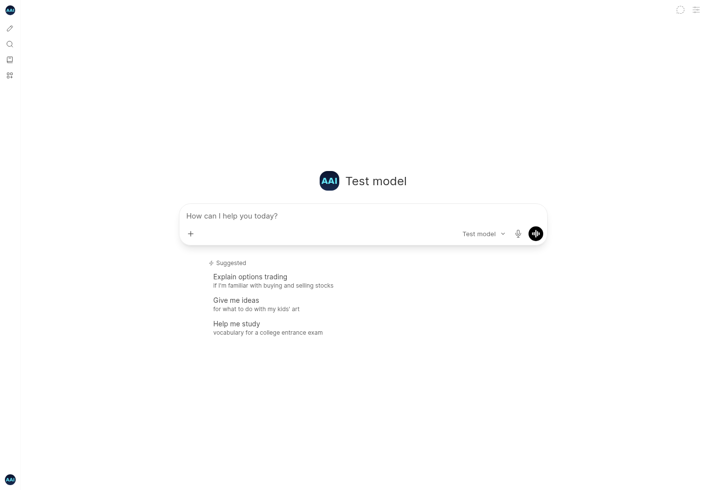

# Chat interface rollback

The requested UI redesign and new Agent/thinking controls have been reverted. The frontend source is restored to commit `4a3610e97`, including the original landing page, composer, suggestions, and styling.

The backend improvements remain:

- Native tool argument validation and structured argument support.
- Resolved-model handling for OpenAI image generation.
- Empty image response failures rather than false success messages.
- Permission-scoped file tools and optional API agent workflow support.

Archive isolation for development tools is also retained. No production multi-user capacity claim is made.

Screenshots of the restored interface are under `docs/screenshots/restored-ui/`. They use mocked account/model APIs, not production user data or live provider calls.

## Verified on 18 October 2026

- Frontend source exactly matches the pre-redesign interface at `4a3610e97`.
- No backend files changed in this rollback.
- 93 frontend tests pass; strict checking reports zero errors and 195 existing warnings.
- Node 22 production build passes.

[Dark desktop](screenshots/restored-ui/desktop-dark.png) · [Mobile](screenshots/restored-ui/mobile-dark.png)
