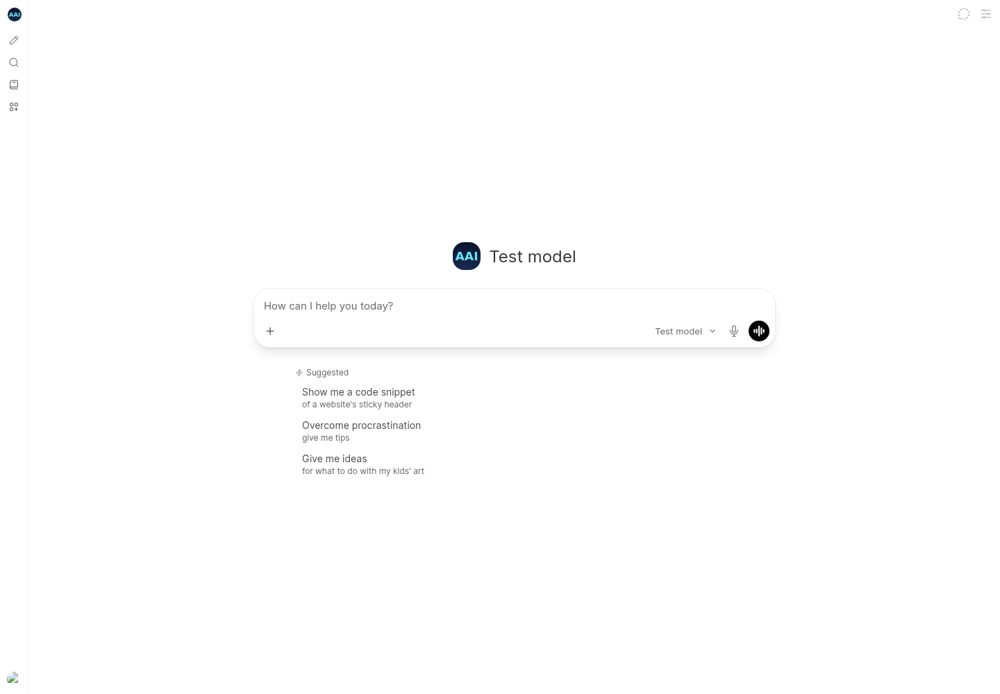
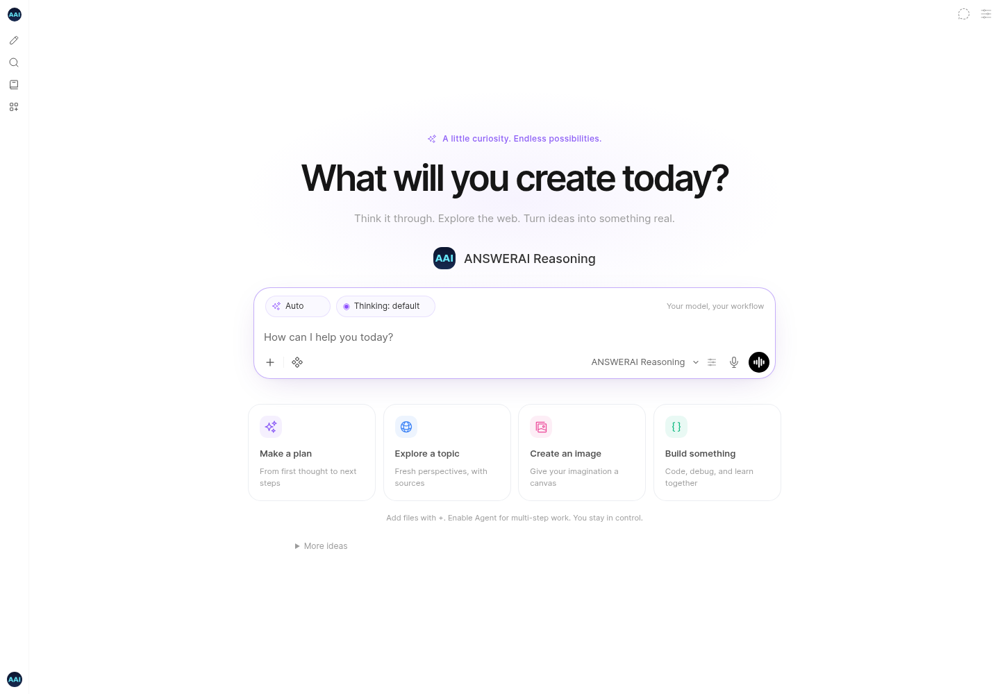

# ANSWERAI chat and agent experience — 17 October 2026

Development branch: `feat/multiuser-agentic-experience` in the private `aai-internal` repository.

## Delivered

- Redesigned chat landing page, clear task starters, a quieter suggestions area, a violet-accented composer, light/dark styling, responsive cards, and reduced-motion support.
- Task starters create editable drafts rather than automatically submitting incomplete requests. Search and image starters retain feature and model permission checks.
- Per-chat Auto / Agent / Chat-only controls. Agent selects the native tool loop; Chat-only disables automatic built-in tool injection for ordinary chats. Explicitly selected custom tools are separate. Existing tool approval controls remain authoritative.
- A thinking selector populated from the selected model's configured reasoning controls. It does not send guessed reasoning parameters to unsupported models. Per-chat choices merge with global choices without overwriting other models; selecting default removes the override from the provider payload.
- Agent instructions adapt to available capabilities: keep visible tasks current for complex work, inspect attached files, cite actual web sources, use the image tool, and explain failures without fabricating results.
- Agent file browsing is available alongside full-file context. Existing user file permissions remain required; this does not grant access to the host filesystem. A configured terminal integration remains necessary for terminal access.
- Native tool execution accepts structured object arguments as well as serialized JSON, and rejects malformed argument types before executing a tool.
- OpenAI image payloads use the resolved model when deciding whether to include `response_format`. GPT image models selected through a fallback/default no longer receive an incompatible parameter because the configured model field was empty.
- Empty image responses are errors instead of false success confirmations.

## Screenshots

The screenshots use a controlled account/model fixture and mocked APIs, not production account data or successful live provider calls.

| Before                                               | After                                              |
| ---------------------------------------------------- | -------------------------------------------------- |
|  |  |

- [Agent and thinking controls](screenshots/agentic/03-agent-thinking.png)
- [Dark theme](screenshots/agentic/04-after-dark.png)
- [390px mobile layout](screenshots/agentic/05-after-mobile.png)

## Verification

- Strict Svelte/TypeScript check: zero errors; 195 pre-existing warnings.
- Frontend: 95 passing tests across 40 files.
- Backend: 155 passing tests, including native tool argument, image payload, empty response, file tool permission, and agent guidance regressions.
- Node 22 production build with `USE_SLIM=true`.
- Browser checks: desktop and mobile layouts; no horizontal page overflow; thinking and agent selections; image starter does not submit a draft; outgoing chat request retains agent mode, native function calling, thinking selection, and image feature flag.
- Archived workspace checkouts are excluded from Docker build contexts, formatting/lint sweeps, and current frontend test discovery.
- Branding audit and whitespace checks. New Python modules/tests pass Ruff. The six modified legacy backend files retain 233 existing Ruff findings; their rule counts did not increase.

Reproduce the browser checks after starting a production preview:

```sh
APP_URL=http://127.0.0.1:4176 \
PLAYWRIGHT_MODULE=/path/to/playwright \
CHROME_BIN=/path/to/chromium \
node scripts/browser/agentic-experience.cjs
```

Install Playwright separately or point `PLAYWRIGHT_MODULE` at an existing installation. The script writes screenshots to `docs/screenshots/agentic`, or `SCREENSHOT_DIR` when set.

## Provider configuration

Image generation still requires an enabled and configured image provider, a compatible model and size, image permissions, an eligible plan, and the image feature selected in chat. Enable native function calling and built-in tools on the chat model for Agent mode. Uploaded documents must finish processing before their extracted text can be searched.

Thinking choices must be configured on the model using its existing model-control editor. For example, a provider supporting `reasoning_effort` can map a named option to `{ "reasoning_effort": "high" }`. Other providers can use their supported reasoning parameter mapping. The selector stays disabled when the model has no configured reasoning choices or multiple models are selected.

No live provider credentials were configured in this execution environment. Real OpenAI/Gemini image generation, external search, and provider reasoning behavior require a credentialed integration test; passing mocked checks does not establish those external services work in a deployment.

## Multi-user rollout still to implement

This branch starts with per-chat control isolation and permission-preserving agent repairs. It does not establish a production concurrency capacity. The broader multi-user rollout still needs PostgreSQL migration/deployment, mandatory shared Redis behavior, shared private upload storage, durable background jobs, per-user/global concurrent generation limits, operational dashboards, and measured multi-instance load/failure tests. Preserve this work on the feature branch until those deployment requirements are validated.
