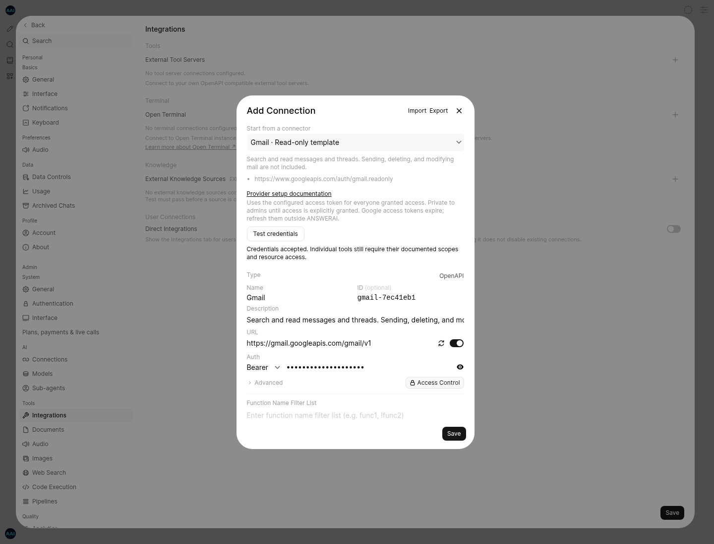

# External connectors testing branch

Branch: `feat/external-connectors`. Chat layout and styling are unchanged.

## Included connectors

| Connector       | Included tools                                                      | Authentication                                              |
| --------------- | ------------------------------------------------------------------- | ----------------------------------------------------------- |
| GitHub          | Read profile, repositories, issues, and pull requests               | Fine-grained personal access token                          |
| Gmail           | Search messages, read messages and threads; decode text MIME bodies | Google access token with `gmail.readonly`                   |
| Slack           | List conversations, read history, search messages                   | Slack token; search requires an eligible user token         |
| Google Drive    | Search files and read metadata                                      | Google access token with `drive.metadata.readonly`          |
| Google Calendar | List calendars and read events                                      | Google access token with `calendar.readonly`                |
| Notion          | Existing hosted MCP tool integration                                | Existing per-user MCP OAuth registration/authorization flow |

The five bundled OpenAPI schemas contain only GET operations. They do not send mail, post Slack messages, modify repositories, change files, or create calendar events. Notion's hosted MCP server determines its own available tools and can expose write operations; existing tool approval and connection access controls still apply. Custom OpenAPI/MCP connections remain available for other services.

## Setup

1. Enable external plugins/tool servers in the deployment (`ENABLE_PLUGINS=true`, `ENABLE_TOOL_SERVERS=true`).
2. Open **Admin → Settings → Integrations**, then add an external tool server.
3. Choose a connector under **Start from a connector**. Its schema, endpoint, and setup documentation are populated.
4. Supply a provider access token and choose **Test credentials**. This checks account authorization, not every tool's scopes or every resource. **Validate schema** only checks the OpenAPI schema.
5. Save the connection. Bearer connections start private to admins. Grant user/group access explicitly only when those users should share the configured provider account.
6. Select the connection's tools in chat. The user's plan, tool permissions, and model tool support must also allow their use.

For Notion, use **Register Client**, save the connection, then use the existing OAuth authorization controls. Registration/discovery and account authorization are separate steps. Connection IDs stay stable when a preset's display name changes.

Google bearer access tokens expire. This branch does not add native Google/Slack OAuth consent applications, automatic refresh-token storage, or per-user account provisioning for these bearer presets. A Google/Slack OAuth application or token-management service must issue/refresh the token, which the administrator then updates in the connection. Notion continues to use the existing MCP OAuth manager.

Drive tools expose metadata; document content import remains available through the existing Drive picker. These connectors query services on demand; they do not continuously synchronize accounts or bulk-index mail/workspaces. Gmail text bodies are decoded into bounded `body.text` fields; malformed data and attachments remain unchanged.

## Tests and implementation boundaries

- 193 backend tests pass, including 38 connector-specific tests.
- 95 frontend tests pass, including preset credential/access isolation and MCP setup defaults.
- Strict frontend checking: zero errors and 195 existing warnings.
- Node 22 production build passes.
- Browser checks cover Gmail setup, expired tokens, Slack scopes, clearing tokens when switching providers, stale-response isolation, private read-only GitHub save, and Notion OAuth setup. Screenshots use mock accounts/providers, not live authorization.
- The actual OpenAPI-to-tool converter and HTTP executor are tested with the supplied schemas, including lowercase boolean query serialization for calendar APIs.
- Credential-test routes require admin access and honor the external-tools switch. They use fixed HTTPS probe URLs, do not follow redirects, enforce a 15-second timeout and bounded response reads, and return no account profile or provider exception contents.
- Selecting another preset clears credentials, cookies, custom headers, OAuth state, and access grants. Credential results are invalidated when inputs change.

Live provider credentials were not configured for this task. Provider policy changes, workspace restrictions, OAuth app approval, real token scopes, provider quotas, and live tool execution must be checked in a credentialed deployment before production use. No live email, Slack message, or Notion write was sent.

## Screenshots



[Slack missing-scope result](screenshots/connectors/slack-scope-check.png) · [Notion OAuth setup](screenshots/connectors/notion-oauth.png)

## Reproduce browser checks

Start a production preview on port 4176, install Playwright separately, then run:

```sh
PLAYWRIGHT_MODULE=/path/to/playwright \
CHROME_BIN=/path/to/chromium \
node scripts/browser/external-connectors.cjs
```

Set `APP_URL` to use another preview URL. The script uses mocked APIs and writes screenshots under `docs/screenshots/connectors/`.
